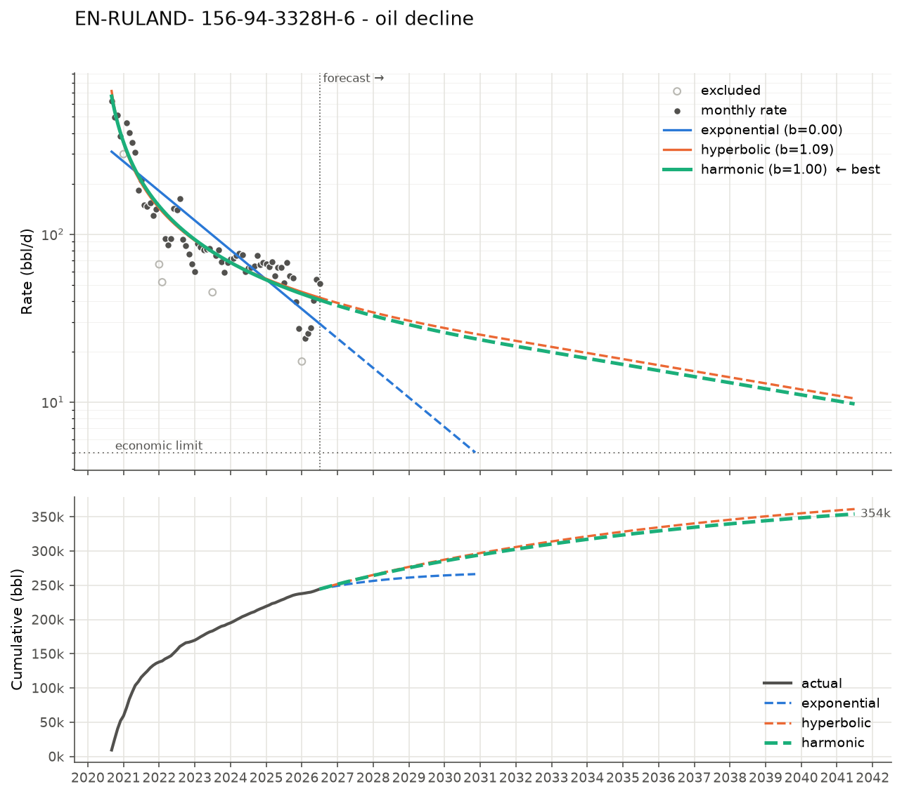
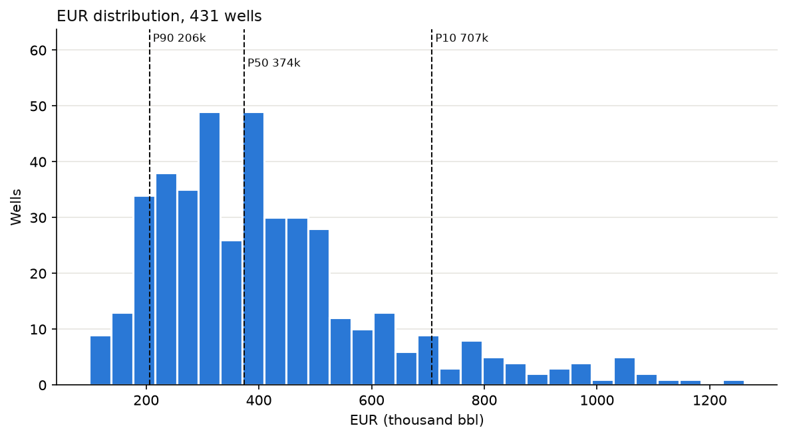
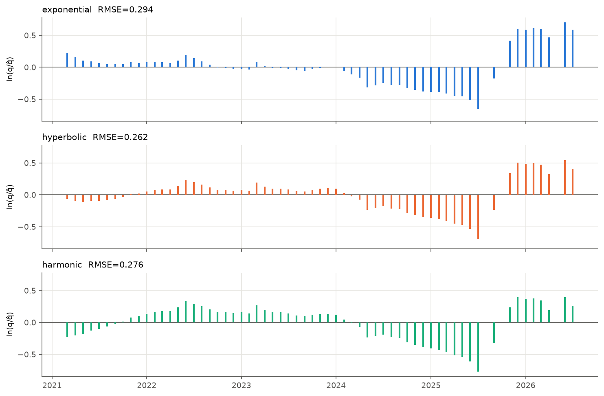

# Decline Curve Analysis

Fit Arps decline models (exponential, hyperbolic, harmonic) to well production
data, forecast future rates, and estimate EUR (estimated ultimate recovery).

Ships with real production data: 431 Bakken horizontal wells that came online in
North Dakota between June 2020 and March 2021, with monthly history through
July 2026, pulled from the
[ND DMR monthly production reports](https://www.dmr.nd.gov/oilgas/mpr/).



## What it does

| Step | Module | Notes |
|---|---|---|
| Get data | `dca/sources/nd_dmr.py` | Downloads and caches ND DMR monthly workbooks, filters by API / file number / pool |
| Clean | `dca/cleaning.py` | Producing-day rates, drops shut-ins and partial months, robust outlier rejection, starts decline at peak, detects refracs/restarts |
| Fit | `dca/fitting.py` | `scipy.optimize.curve_fit` on ln(q) with bounds; model choice by AIC |
| Forecast | `dca/forecast.py` | Modified hyperbolic with terminal decline, economic limit, monthly forecast table, EUR per model |
| Plot | `dca/plotting.py` | Rate + cumulative forecast, residual diagnostics, EUR distribution |

## Install

```bash
python -m venv .venv && source .venv/bin/activate
pip install -e ".[dev]"
```

## Usage

Analyze one well from the bundled dataset:

```bash
dca analyze data/sample/nd_bakken_2020_cohort.csv.gz --well 33061045480000 --plot out/well.png
```

```
Well 33061045480000
  decline start 2020-09, 66 months fitted, last data 2026-07

  exponential qi=   310.1/d  Di= 33.3%/yr eff  b=0.00  RMSE(ln q)=0.344  R2=0.773  AIC= -136.8
  hyperbolic  qi=   712.7/d  Di= 75.2%/yr eff  b=1.09  RMSE(ln q)=0.235  R2=0.894  AIC= -185.0
  harmonic    qi=   663.3/d  Di= 72.5%/yr eff  b=1.00  RMSE(ln q)=0.237  R2=0.893  AIC= -186.3

  best model (AIC): harmonic
  cum to date :      244,349 bbl
  remaining   :      130,515 bbl  (23.0 yrs, ends at economic limit)
  EUR         :      374,864 bbl
```

Run the whole cohort:

```bash
dca batch data/sample/nd_bakken_2020_cohort.csv.gz -o out/summary.csv --plot out/eur.png
```

```
analyzed 431/431 wells
best_model
hyperbolic     275
harmonic       119
exponential     37
EUR P90/P50/P10: 205,972 / 373,816 / 707,128
```



Pull other wells straight from the state (files are cached in `~/.cache/dca/nd_dmr`):

```bash
dca fetch-nd --start 2020-01 --end 2026-07 --api 33061045480000 -o out/well.csv
dca fetch-nd --start 2022-01 --end 2026-07 --pool BAKKEN -o out/bakken.csv   # every Bakken well
```

Useful options for `analyze` / `batch`:

| Flag | Default | Meaning |
|---|---|---|
| `--phase` | `oil` | `oil`, `gas` or `water` |
| `--econ-limit` | `5` | rate (per day) at which the well is abandoned |
| `--dmin` | `0.08` | terminal effective annual decline; `0` turns it off |
| `--b-max` | `2.0` | upper bound on b (use `1.0` for a conventional/BDF-only interpretation) |
| `--half-life` | off | weight recent months more heavily (days) |
| `--horizon` | `50` | cap on forecast length (years) |

Or use the library directly:

```python
import pandas as pd
from dca.analysis import analyze_well
from dca.forecast import ForecastSettings

df = pd.read_csv("data/sample/nd_bakken_2020_cohort.csv.gz", dtype={"api": str}, parse_dates=["date"])
well = df[df["api"] == "33061045480000"]
a = analyze_well(well, settings=ForecastSettings(econ_limit=10, terminal_decline=0.06))
print(a.eur.eur, a.best.b)
a.forecast.head()   # monthly forecast: date, rate, volume, cum
```

## The models

With `t` in days, `qi` the rate at the start of decline and `Di` the initial
nominal decline (1/day):

| Model | Rate | Cumulative |
|---|---|---|
| Exponential (b = 0) | q = qi·e^(−Di·t) | Np = (qi − q) / Di |
| Hyperbolic (0 < b) | q = qi / (1 + b·Di·t)^(1/b) | Np = qi^b / ((1−b)·Di) · (qi^(1−b) − q^(1−b)) |
| Harmonic (b = 1) | q = qi / (1 + Di·t) | Np = (qi / Di) · ln(1 + Di·t) |

**Modified hyperbolic.** Shale wells routinely fit with b > 1 (long transient
linear flow). A pure hyperbolic with b ≥ 1 has infinite cumulative production,
so forecasts switch to an exponential once the instantaneous decline
D(t) = Di / (1 + b·Di·t) falls to a terminal decline `Dmin` (8 %/yr by default).
`Dmin` is also a floor for every model, so a flat fit can't forecast forever.

**EUR** = actual cumulative to date + model volume from the last data month to
the economic limit (or horizon). Anchoring the remaining volume on actual
cumulative keeps early-time misfit out of the reserves number.

## Design notes

- **Fit in log space.** Production noise is multiplicative. Fitting q directly
  lets the first few high-rate months dominate the residuals; fitting ln(q)
  weights the tail, which is what drives EUR.
- **Producing-day rates.** Monthly volume / days on production, not calendar
  days, so a well that ran 12 days doesn't look like it fell off a cliff. Months
  under 10 producing days are excluded (they're still counted in cumulative).
- **Outliers** are rejected with a robust (MAD-based) z-score against a rolling
  median in log space, with a floor on the spread so smooth series don't flag
  ordinary noise.
- **Restarts.** A sustained jump > 2.5× the trailing median (refrac, cleanout)
  starts a new decline segment, if it has at least 12 months of history.
  Without that minimum, one well in the cohort (KERMIT 3-8-32UTFH) fit a
  10-month flat segment after a 2025 restart and came out at 2.9 MMbbl.
- **Model selection** uses AIC so the hyperbolic has to earn its extra
  parameter.
- **P90/P50/P10** follow the petroleum convention: P90 is the low case.

## Reading the diagnostics

The residual plot (`*_residuals.png`) is the quickest way to see whether a fit
can be trusted. Residuals with a pattern instead of random scatter mean the
well changed behaviour. In this well the residuals turn sharply positive in
late 2025 (a step-up in rate, probably artificial lift or a workover) that's
too small to count as a restart:



In that case `--half-life 365` weights the recent trend more, and EUR moves from
1.26 to 1.49 MMbbl. Which one to believe depends on what happened to the well,
and the data alone can't tell you that.

## Limitations

- Arps is empirical. It assumes constant operating conditions and, strictly,
  boundary-dominated flow; b > 1 is a curve-fit convenience, not physics.
- No economics beyond a flat rate cutoff (no prices, opex, or NPV).
- Gas and water use the same workflow as oil; there's no GOR/WOR or
  ratio-based forecasting.
- ND DMR monthly reports go back to 2003. Only the window you download is
  used, so cumulative is "cumulative since the start of the window". The
  bundled cohort starts before first production, so its cumulatives are
  complete.

## Tests

```bash
pytest
```

Tests check the closed-form cumulatives against numerical integration, recover
known parameters from synthetic data, and cover the cleaning steps and EUR
bookkeeping.

## Data

`data/sample/nd_bakken_2020_cohort.csv.gz` comes from the North Dakota Department
of Mineral Resources, Oil and Gas Division monthly production reports
(public). Columns: `date, api, file_no, well_name, operator, field, county,
oil_bbl, gas_mcf, water_bbl, days_on`.
